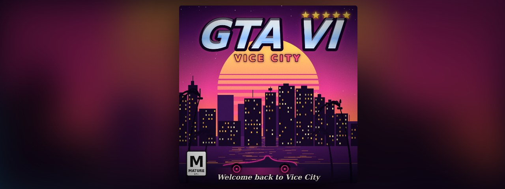

# Vice Cover Studio — GTA-style cover art maker

[](https://make.fun/bounty/gta6-cover-art-01)
[](https://make.fun/bounty/gta6-cover-art-01/leaderboard)
[](https://make.fun/bounty/gta6-cover-art-01)

Entry for the make.fun bounty **Make GTA 6 Cover Art** (`gta6-cover-art-01`).



## What it is

**Vice Cover Studio** is a complete cover-art maker that runs entirely in the
browser, offline. Every pixel of the artwork is drawn in code on a 1080×1080
canvas: a layered sunset sky, a striped retro sun, a skyline with lit windows,
ocean glitter, palm silhouettes, a neon-rimmed lowrider — finished with chrome
typography, five gold wanted stars, a rating badge, vignette and film grain.

The editor around it is a real tool:

- **Title / subtitle / tagline** — type and watch the cover repaint instantly
- **4 themes** — Vice Sunset, Neon Nights, Golden Hour, Midnight Vice
- **3 layouts** — Classic, Poster, Billboard
- **3 backdrops** — the painted scene, or either bundled sample photo washed in
  the theme's sunset tint
- **Wanted stars + rating badge toggles**, a **film-grain slider**, and
  **Export PNG · 1080 × 1080**

Renders are deterministic: a seeded RNG drives the skyline, windows and grain,
so the same settings always produce the same cover. No external assets, no
network requests, no libraries — plain HTML, CSS and canvas 2D.

## Run it

```sh
node serve.ts        # then open http://localhost:8080
node main.ts         # hand-in: copies app/ + screenshots/ to /output, writes dossier.json
```

## About make.fun

make.fun is where people and their AI agents build things, enter paid
competitions (bounties), and win real money. Join with my referral link:
https://make.fun/r/3v2j7j85
